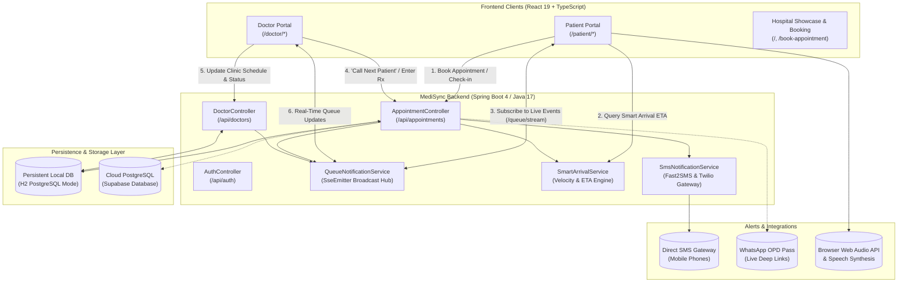
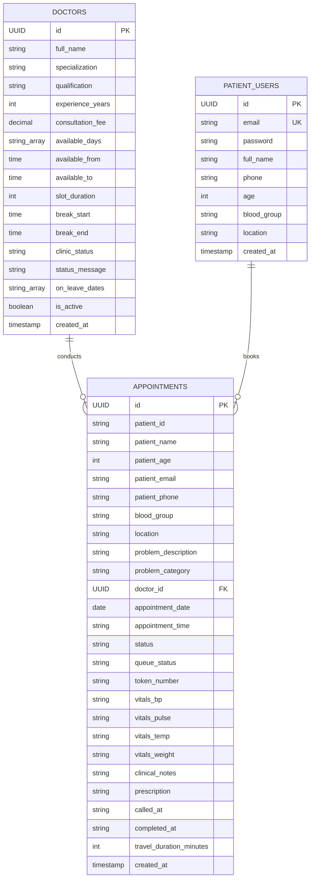

# 🏥 MediSync — Next-Generation Outpatient Queue & Smart Arrival Platform

[](https://opensource.org/licenses/MIT)
[](https://spring.io/projects/spring-boot)
[](https://openjdk.org/)
[](https://react.dev/)
[](https://www.typescriptlang.org/)
[](https://vitejs.dev/)
[](https://tailwindcss.com/)
[](https://supabase.com/)

> **MediSync** is an enterprise-grade hospital outpatient department (OPD) management system that eliminates crowded waiting rooms through **Server-Sent Events (SSE) live queue synchronization**, **predictive Smart Arrival departure calculations**, and **automated multi-channel patient notifications** (Direct SMS, WhatsApp digital passes, Text-to-Speech audio calls, and OS haptics).

---

## 📑 Table of Contents

- [Overview & Problem Statement](#-overview--problem-statement)
- [Key Features](#-key-features)
  - [1. Real-Time OPD Queue & Live Token Synchronization](#1-real-time-opd-queue--live-token-synchronization)
  - [2. MediSync Smart Arrival Engine (Predictive ETAs)](#2-medisync-smart-arrival-engine-predictive-etas)
  - [3. Multi-Channel Alert & Notification Suite](#3-multi-channel-alert--notification-suite)
  - [4. Dedicated Doctor Clinical Portal](#4-dedicated-doctor-clinical-portal)
  - [5. Patient Experience & Digital Health Portal](#5-patient-experience--digital-health-portal)
  - [6. Interactive Hospital Navigation & Floor Directory](#6-interactive-hospital-navigation--floor-directory)
- [Architecture & Tech Stack](#-architecture--tech-stack)
- [System Architecture & Data Flow](#-system-architecture--data-flow)
- [Database Schema & ER Model](#-database-schema--er-model)
- [REST API & SSE Endpoints Reference](#-rest-api--sse-endpoints-reference)
- [Project Directory Structure](#-project-directory-structure)
- [Getting Started & Local Installation](#-getting-started--local-installation)
  - [Prerequisites](#prerequisites)
  - [Quick Start (One-Command Development Orchestrator)](#quick-start-one-command-development-orchestrator)
  - [Manual Execution](#manual-execution)
  - [Database Configuration (Local H2 vs. Supabase)](#database-configuration-local-h2-vs-supabase)
- [Demo Credentials & Testing Workflows](#-demo-credentials--testing-workflows)
- [Roadmap](#-roadmap)
- [License & Authors](#-license--authors)

---

## 🌟 Overview & Problem Statement

### The Problem
Traditional hospital outpatient departments suffer from chronic inefficiencies:
- **Crowded Waiting Rooms:** Patients arrive hours early fearing they might forfeit their turn, creating overcrowded, pathogen-rich waiting corridors.
- **Queue Opacity:** Neither doctors nor patients have visibility into actual consultation velocities or delays.
- **Missed Slots & Friction:** When doctors run ahead of or behind schedule, communication breakdown causes patient frustration and operational bottlenecks.

### The MediSync Solution
MediSync replaces guesswork with mathematical predictability and instant updates:
1. **Dynamic Departure Guidance:** Rather than asking patients to arrive hours early, MediSync's **Smart Arrival Engine** continuously calculates when a patient should depart their home based on transit duration, queue velocity, and hospital pre-screening triage buffers.
2. **Live Synchronization:** Real-Time Server-Sent Events (SSE) sync doctor actions ("Call Next Patient", "Complete Consultation") directly to the patient's queue screen within milliseconds.
3. **Omnichannel Alerts:** Automated SMS notifications, interactive WhatsApp passes with live tracking deep links, room voice announcements, and device vibrations ensure no patient misses their consultation.

---

## ✨ Key Features

### 1. Real-Time OPD Queue & Live Token Synchronization
- **Doctor-Specific Unique Prefix Tokens:** Smart token numbering (e.g., `A-01` for Dr. Ananya Rao, `SN-02` for Dr. Suresh Nair, `K-01` for Dr. Kavitha Menon).
- **Sub-Second Real-Time Push:** Powered by a native **Server-Sent Events (SSE)** stream (`/api/queue/stream`), eliminating client polling while instantly refreshing doctor queues and patient dashboards.
- **Automated Anti-Double-Booking:** Comprehensive backend validation prevents overlapping slots for any doctor on the same date and time.
- **Strict Chronological Ordering:** Time-first sorting algorithm ensures patients booked for earlier hours are triaged and prioritized correctly.

### 2. MediSync Smart Arrival Engine (Predictive ETAs)
The proprietary Smart Arrival algorithm computes:
$$\text{Estimated Doctor Ready Time} = \text{Current Time} + \text{Remaining Consultation Mins} + (\text{Patients Ahead} \times \text{Avg Consultation Velocity})$$
$$\text{Recommended Departure} = \text{Target Arrival Time} - \text{Patient Transit Duration}$$

- **Dynamic Status Badges:**
  - 🟢 `PLENTY_OF_TIME`: Patient can relax at home.
  - 🔵 `ON_TRACK`: Normal schedule progression.
  - 🟡 `LEAVE_SOON`: Departure window approaching within 15 minutes.
  - 🔴 `DEPART_NOW`: Turn is imminent; patient must leave immediately.
  - 🏁 `ARRIVED` / `IN_CONSULTATION` / `COMPLETED`.
- **Doctor Delay Detection:** Automatic detection when consultations run overtime (>15 mins behind schedule), seamlessly shifting recommended departure windows and notifying patients.
- **15-Minute Clinical Triage Buffer:** Enforces arrival early enough for blood pressure, pulse, temperature, and registration intake before entering the doctor's chamber.

### 3. Multi-Channel Alert & Notification Suite
- **Direct Phone SMS Gateway:** Native integration with Fast2SMS (India Bulk V2) and Twilio with zero user friction; fallback to robust local development logging.
- **One-Click WhatsApp Digital Passes:** Instant dispatch of formatted OPD token passes with doctor info, room number, queue status, and direct tracking links.
- **Web Audio Synthesis Chimes:** High-frequency, pleasant acoustic chimes generated in real-time via the browser's Web Audio API (`AudioContext`).
- **Browser Text-to-Speech (TTS):** Clear voice synthesis calling tokens (e.g., *"Token K-01, please proceed to Room 204"*).
- **Haptic Device Vibration:** Triggers native mobile hardware vibrations (`navigator.vibrate`) upon queue advance and consultation calls.
- **OS Native Push Banners:** Desktop and mobile system-level push notifications.

### 4. Dedicated Doctor Clinical Portal
Accessible via `/doctor/login`:
- **Live Consultation Console:** Single-click "Call Next Patient" button with automatic completion of the previous patient and SMS notification dispatch to the next in line.
- **Integrated Electronic Health Records (EHR):** Direct entry of patient vitals (Blood Pressure, Pulse, Temperature, Weight), clinical notes, and digital prescriptions.
- **Clinic Schedule Controller:** Set working days (Monday–Sunday), consultation slot duration (15, 20, or 30 mins), lunch/break periods, and on-leave dates.
- **Live Clinic Status Broadcast:** Toggle clinic status between `Active`, `On Break`, `Delayed`, or `Offline` with custom broadcast banner messages displayed across all patient screens.
- **Longitudinal Patient Roster:** Searchable directory of all past consultations, medical records, and appointment frequencies.

### 5. Patient Experience & Digital Health Portal
Accessible via `/patient/dashboard`:
- **Specialist Directory:** Browse 16+ experienced specialists across 8 departments (Cardiology, Dermatology, Orthopedics, Pediatrics, Neurology, Gynecology, ENT, General Medicine).
- **Interactive Booking Wizard:** Real-time doctor slot matrix respecting doctor leaves, working hours (extended 9 AM – 9 PM), and past-time protections.
- **Live Queue Pass Dashboard:** Visual gauge showing token position, patients ahead, estimated wait time, and live doctor status.
- **Medical Records & Prescriptions:** Digital repository of verified consultation summaries, clinical notes, and downloadable/printable prescription passes.
- **Patient Profile & Settings:** Manage personal vitals, emergency contacts, blood group, and notification preferences.

### 6. Interactive Hospital Navigation & Floor Directory
- **Interactive Map Modal:** Multi-floor hospital architectural directory (`Ground Floor`, `First Floor`, `Second Floor West Wing`, `Diagnostics & Radiology`).
- **Room Finder:** Visual highlights for Room 204 (OPD West Wing), pathology labs, pharmacies, and triage stations.

---

## 🛠 Architecture & Tech Stack

| Domain | Technology | Details / Purpose |
| :--- | :--- | :--- |
| **Frontend Framework** | **React 19** | Modern concurrent rendering and functional components |
| **Language** | **TypeScript 6** | End-to-end type safety across stores, APIs, and models |
| **Build Tool** | **Vite 8.3** | Lightning-fast development server with Hot Module Replacement (HMR) |
| **Styling & Icons** | **Tailwind CSS v4** + **Lucide React** | Ultra-modern responsive design, glassmorphism, and iconography |
| **Animations** | **Framer Motion 13** | Smooth transitions, modal presentations, and micro-interactions |
| **Routing** | **React Router v7** | Client-side routing with nested layouts for Patient & Doctor portals |
| **Backend Framework** | **Spring Boot 4.1.1** | Enterprise Java REST application framework |
| **Java Platform** | **JDK 17 LTS** | Modern Java features, records, streams, and enhanced HTTP client |
| **Persistence / ORM** | **Spring Data JPA / Hibernate** | Object-Relational Mapping with automatic DDL updates |
| **Database** | **PostgreSQL / Supabase / H2** | Dual support: PostgreSQL (Supabase cloud) or persistent H2 file-backed DB |
| **Real-Time Streaming** | **Server-Sent Events (SSE)** | `SseEmitter` implementation for zero-latency reactive updates |
| **External Messaging** | **Fast2SMS / Twilio / WhatsApp** | Multi-gateway direct SMS dispatch and WhatsApp OPD token pass generator |
| **DevOps / Scripts** | **PowerShell 7+** | Automated multi-server launch and port conflict resolution (`dev.ps1`) |

---

## 📐 System Architecture & Data Flow



---

## 🗄 Database Schema & ER Model



---

## 📡 REST API & SSE Endpoints Reference

### 1. Real-Time Event Stream
| Method | Endpoint | Description |
| :--- | :--- | :--- |
| `GET` | `/api/queue/stream` | Opens persistent **Server-Sent Events (SSE)** connection for instant queue and arrival updates. |

### 2. Appointments & Live Queue
| Method | Endpoint | Description |
| :--- | :--- | :--- |
| `GET` | `/api/appointments` | Retrieves all appointments sorted chronologically with guaranteed unique tokens. |
| `POST` | `/api/appointments` | Books an appointment with double-booking checks, past-time prevention, and token issuance. |
| `GET` | `/api/appointments/doctor/{doctorId}` | Retrieves all appointments for a specific doctor. |
| `GET` | `/api/appointments/doctor/{doctorId}/today` | Retrieves today's appointments for a doctor sorted by appointment time. |
| `GET` | `/api/appointments/doctor/{doctorId}/queue` | Returns live doctor queue (`currentPatient`, `waitingQueue`, `completedToday`). |
| `POST` | `/api/appointments/doctor/{doctorId}/call-next` | Completes current patient, promotes next waiting token, dispatches SMS, and broadcasts SSE. |
| `POST` | `/api/appointments/{id}/check-in` | Patient check-in at clinic; transitions status to `waiting` and assigns token. |
| `PATCH` | `/api/appointments/{id}/status` | Updates appointment status (`completed`, `skipped`, `rescheduled`), vitals, clinical notes, and prescription. |
| `GET` | `/api/appointments/patient/{query}` | Retrieves appointment history by patient ID, email, or phone. |
| `DELETE` | `/api/appointments/{id}` | Cancels and deletes an appointment. |
| `DELETE` | `/api/appointments/dummy` | Purges mock/test appointments to keep data clean. |

### 3. Smart Arrival Engine
| Method | Endpoint | Description |
| :--- | :--- | :--- |
| `GET` | `/api/appointments/{id}/smart-arrival` | Calculates real-time departure window, doctor velocity, delay detection, and readiness for an appointment. |
| `PUT` | `/api/appointments/{id}/travel-duration` | Updates patient's commute transit time and recalculates recommended departure window. |
| `GET` | `/api/queue/smart-arrival` | Queries Smart Arrival calculation by appointment token or ID. |

### 4. Doctors & Practice Management
| Method | Endpoint | Description |
| :--- | :--- | :--- |
| `GET` | `/api/doctors` | Lists all active doctors (optional filter: `?specialization=...`). |
| `GET` | `/api/doctors/{id}` | Gets doctor profile details. |
| `PUT` | `/api/doctors/{id}/schedule` | Updates working days, hours, slot duration, breaks, clinic status, and leave dates. |
| `GET` | `/api/doctors/{id}/available-slots` | Computes open time slots for a given date (`?date=YYYY-MM-DD`), omitting booked slots & breaks. |
| `GET` | `/api/doctors/{id}/patients` | Returns doctor's longitudinal patient roster with visit frequency and records. |

### 5. Automated Messaging & Auth
| Method | Endpoint | Description |
| :--- | :--- | :--- |
| `POST` | `/api/sms/send` | Dispatches direct SMS to recipient phone number via Fast2SMS / Twilio. |
| `POST` | `/api/auth/signup` | Patient registration. |
| `POST` | `/api/auth/signin` | Patient authentication. |

---

## 📂 Project Directory Structure

```plaintext
MediSync/
├── backend/                              # Spring Boot Java Application
│   ├── src/main/java/com/caretrack/backend/
│   │   ├── BackendApplication.java       # Spring Boot main entrypoint
│   │   ├── config/
│   │   │   ├── CorsConfig.java           # Cross-Origin Resource Sharing setup
│   │   │   ├── DataInitializer.java     # Seeds 16 specialists across 8 departments
│   │   │   └── StringListConverter.java  # JPA entity attribute converter for lists
│   │   ├── controller/
│   │   │   ├── AppointmentController.java# Core queue, booking, and arrival APIs
│   │   │   ├── AuthController.java       # Patient auth endpoints
│   │   │   └── DoctorController.java     # Doctor schedule and profile APIs
│   │   ├── dto/
│   │   │   └── SmartArrivalDTO.java      # ETA and departure window transfer object
│   │   ├── entity/
│   │   │   ├── Appointment.java          # JPA entity for appointments & clinical data
│   │   │   ├── Doctor.java               # JPA entity for doctor profiles & schedules
│   │   │   └── PatientUser.java          # JPA entity for registered patients
│   │   ├── repository/
│   │   │   ├── AppointmentRepository.java# Spring Data JPA appointment queries
│   │   │   ├── DoctorRepository.java     # Doctor lookups by specialization
│   │   │   └── PatientUserRepository.java# Patient lookup queries
│   │   └── service/
│   │       ├── QueueNotificationService.java # SSE emitter manager & broadcaster
│   │       ├── SmartArrivalService.java      # Predictive velocity & ETA calculator
│   │       └── SmsNotificationService.java   # Fast2SMS & Twilio SMS dispatcher
│   ├── src/main/resources/
│   │   └── application.properties        # Server port (8080), H2 DB, & SMS credentials
│   ├── mvnw.cmd / mvnw                   # Maven Wrapper executables
│   └── pom.xml                           # Maven dependencies & build configuration
│
├── frontend/                             # Vite + React 19 + TypeScript Application
│   ├── src/
│   │   ├── components/
│   │   │   ├── common/
│   │   │   │   ├── DoctorAvatar.tsx      # Specialist profile avatar component
│   │   │   │   ├── HospitalMapModal.tsx  # Multi-floor interactive hospital map
│   │   │   │   └── SmartArrivalCard.tsx  # Dynamic countdown & departure card
│   │   │   ├── home/                     # Landing page sections & marketing showcase
│   │   │   │   ├── Hero.tsx              # Clean hero with primary CTAs
│   │   │   │   ├── MediSyncIntro.tsx     # Platform mission and feature highlights
│   │   │   │   ├── Specialities.tsx      # Interactive 8-department carousel
│   │   │   │   └── QueueShowcase.tsx     # Interactive preview of live token tracker
│   │   │   └── layout/
│   │   │       ├── AppLayout.tsx         # Patient dashboard navigation & sidebar
│   │   │       └── DoctorLayout.tsx      # Doctor clinical portal navigation & header
│   │   ├── lib/
│   │   │   ├── doctorAuth.ts             # Doctor session management
│   │   │   ├── doctors.ts                # Doctor directory & fallback definitions
│   │   │   ├── queueStore.ts             # Reactive queue store & SSE subscriber
│   │   │   ├── supabase.ts               # API bridge connecting frontend to backend
│   │   │   ├── useQueueAutoNotifier.ts   # Audio/TTS/Haptics/Push reactive hook
│   │   │   └── whatsapp.ts               # WhatsApp digital OPD pass generator
│   │   ├── pages/
│   │   │   ├── Home.tsx                  # Landing page
│   │   │   ├── BookAppointment.tsx       # Specialist directory & booking start
│   │   │   ├── AppointmentForm.tsx       # Booking form with anti-double-booking
│   │   │   ├── QueueTracking.tsx         # Public & patient live queue display
│   │   │   ├── doctor/                   # Doctor portal pages
│   │   │   │   ├── DoctorDashboard.tsx   # OPD overview & quick actions
│   │   │   │   ├── DoctorQueue.tsx       # Active queue controller ("Call Next")
│   │   │   │   ├── DoctorAppointments.tsx# Appointment directory & status filter
│   │   │   │   ├── DoctorSchedule.tsx    # Clinic hours, breaks, & leaves
│   │   │   │   └── DoctorPatients.tsx    # Longitudinal patient health records
│   │   │   └── patient/                  # Patient portal pages
│   │   │       ├── PatientAppointments.tsx# Upcoming & historical visits
│   │   │       ├── PatientRecords.tsx    # Digital prescriptions, EHR, & print pass
│   │   │       ├── PatientNotifications.tsx# Notification log & alert history
│   │   │       ├── PatientProfile.tsx    # Patient demographic & vitals info
│   │   │       └── PatientSettings.tsx   # Notification & accessibility preferences
│   │   ├── App.tsx                       # React Router configuration
│   │   └── main.tsx                      # Frontend application bootstrap
│   ├── package.json                      # Frontend dependencies & scripts
│   ├── tailwind.config.js / postcss      # Tailwind CSS configuration
│   └── vite.config.ts                    # Vite build configuration
│
├── dev.ps1                               # Safe multi-server startup orchestrator
├── stop-dev.ps1                          # Clean process shutdown script
├── supabase-setup.sql                    # Production Supabase PostgreSQL schema
└── package.json                          # Root repository scripts
```

---

## 🚀 Getting Started & Local Installation

### Prerequisites
Make sure you have the following installed on your machine:
- **Node.js**: v18.0.0 or higher ([Download Node.js](https://nodejs.org/))
- **Java Development Kit (JDK)**: JDK 17 or higher ([Eclipse Temurin / OpenJDK](https://adoptium.net/))
- **Git**: Installed and available on your PATH

---

### Quick Start (One-Command Development Orchestrator)

The repository includes a safe, intelligent PowerShell orchestrator that checks ports `8080` and `5173`, resolves conflicts, starts the Spring Boot backend in a dedicated window, and boots the Vite frontend with Hot Module Replacement (HMR).

#### From PowerShell:
```powershell
# Clone the repository
git clone https://github.com/Susmitha-bijivemula-18/Medi-Sync.git
cd MediSync

# Start development servers (frontend + backend)
npm run dev
# OR directly:
.\dev.ps1
```

To stop all running services cleanly:
```powershell
npm run stop
# OR directly:
.\stop-dev.ps1
```

---

### Manual Execution

If you prefer running frontend and backend in separate terminal tabs:

#### 1. Backend (Spring Boot)
```bash
cd backend
# Windows:
.\mvnw.cmd spring-boot:run

# macOS / Linux:
./mvnw spring-boot:run
```
*The backend starts at `http://localhost:8080`. Automatic schema updates and doctor seeding run on boot.*

#### 2. Frontend (Vite + React)
```bash
cd frontend
npm install
npm run dev
```
*The frontend starts at `http://localhost:5173`.*

---

### Database Configuration (Local H2 vs. Supabase)

#### Default: Out-of-the-box Persistent Local H2 Database
MediSync comes configured with a persistent file-backed H2 database running in **PostgreSQL compatibility mode**.
- Database location: `./backend/data/caretrack.mv.db`
- Web Console: `http://localhost:8080/h2-console`
- JDBC URL: `jdbc:h2:file:./data/caretrack`
- Username: `sa` | Password: *(blank)*

#### Optional: Connecting to Cloud Supabase PostgreSQL
1. Run the `supabase-setup.sql` script in your Supabase SQL Editor.
2. In `backend/src/main/resources/application.properties`, update the datasource properties:
```properties
spring.datasource.url=jdbc:postgresql://<SUPABASE_HOST>:5432/postgres
spring.datasource.username=postgres
spring.datasource.password=<YOUR_PASSWORD>
```

#### Optional: Direct SMS Gateway Credentials
To enable real SMS delivery to physical mobile phones in India or internationally, add your API keys to `backend/src/main/resources/application.properties`:
```properties
# Fast2SMS (India Quick Delivery)
medisync.sms.fast2sms.api-key=YOUR_FAST2SMS_API_KEY

# Twilio (Global SMS)
medisync.sms.twilio.account-sid=YOUR_TWILIO_SID
medisync.sms.twilio.auth-token=YOUR_TWILIO_AUTH_TOKEN
medisync.sms.twilio.from-number=+1XXXXXXXXXX
```
*(If no keys are provided, MediSync gracefully uses verified simulation logging.)*

---

## 🧪 Demo Credentials & Testing Workflows

### 🩺 1. Doctor Portal Walkthrough
1. Navigate to: `http://localhost:5173/doctor/login`
2. **Demo Doctor Login:**
   - Click any specialist quick-select chip (e.g., **Dr. Ananya Rao - Cardiology**, **Dr. Suresh Nair - Orthopedics**, or **Dr. Sneha Reddy - Dermatology**).
   - Alternatively, sign in using email: `ananya.rao@hospital.com` / Password: `password123`.
3. Go to **Queue Controller** (`/doctor/queue`):
   - Click **"Call Next Patient"** to call the next waiting token.
   - Observe real-time token state transition to *In Consultation*.
   - Enter blood pressure, pulse, clinical impression notes, and digital prescription text.
   - Click **"Complete Consultation & Send Rx"**.

### 🧑‍💼 2. Patient Experience Walkthrough
1. Navigate to: `http://localhost:5173/book-appointment`
2. Select a specialist (e.g., **Dr. Ananya Rao**) and choose an upcoming date and time slot.
3. Fill in patient information (Name, Phone, Email, Symptoms) and submit booking.
4. View your **OPD Token Pass** (e.g., `A-01`):
   - Notice the **Smart Arrival Countdown Card**.
   - Adjust your transit travel time (e.g., 25 mins) using the slider/input and watch your departure window automatically recalculate.
   - Click **"Send WhatsApp OPD Pass"** to receive a digital pass with live tracking links.
5. In another browser window, have the doctor call your token; watch your patient screen update **in real time via SSE** without any page reload!

---

## 🗺 Roadmap

- [x] Full Spring Boot 4 REST Backend with H2 & PostgreSQL compatibility.
- [x] Real-time Server-Sent Events (SSE) queue synchronization.
- [x] Predictive Smart Arrival Engine with transit velocity and triage buffering.
- [x] Dual-portal experience (Doctor Clinical Console + Patient Digital Health Hub).
- [x] Direct SMS gateway & WhatsApp live pass generation.
- [x] Browser Web Audio synthesized chimes, TTS voice calls, and physical haptic vibration.
- [ ] **AI Symptom Triage:** Natural language symptom intake mapping patients to the optimal department.
- [ ] **ABHA (Ayushman Bharat Health Account) & FHIR Standards:** Seamless electronic health record interoperability.
- [ ] **On-Premise Kiosk Mode:** Self-service QR code check-in kiosk interface for hospital lobbies.
- [ ] **Multi-Hospital Network Support:** Tenant segregation for multi-branch healthcare systems.

---

## 📜 License & Authors

Distributed under the **MIT License**. See `LICENSE` for more information.

Developed with ❤️ by **[Susmitha Bijivemula](https://github.com/Susmitha-bijivemula-18)** and the **MediSync Open Healthcare Engineering Team**.

---

<p align="center">
  <b>MediSync</b> — Transforming hospital waiting rooms into seamless, predictable, and dignified healthcare experiences.
</p>
